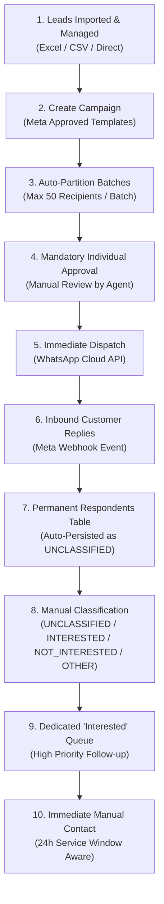

# Travel Agency WhatsApp Campaign & Respondent Management CRM

A production-grade WhatsApp campaign and respondent management platform designed for travel agencies, built with **Python 3.12**, **FastAPI**, **SQLAlchemy 2.0**, **psycopg 3**, **Neon PostgreSQL**, **Alembic**, and a responsive **Vanilla JavaScript/CSS SaaS Dashboard**.

---

## Architecture & Final Business Workflow

The system provides a streamlined, human-supervised WhatsApp campaign dispatch and customer relationship management workflow:



### Core Business Workflow Rules:
1. **Lead Management:** Leads are imported from verified Excel/CSV files or entered directly. Opt-in consent (`OPTED_IN` vs `OPTED_OUT`) is strictly tracked and enforced.
2. **Immediate Campaigns:** Broadcast campaigns target consented leads partitioned into batches of **maximum 50 recipients**.
3. **Mandatory Batch Approval:** Every batch must be individually reviewed and approved before sending.
4. **Immediate Dispatch:** Sending a batch dispatches immediately. **Zero future scheduling or background job queues**.
5. **Permanent Respondent Capture:** Inbound WhatsApp replies received via Meta webhook are permanently stored in the `respondents` table. Deduplication is enforced by normalized phone number.
6. **Strict Classification:** Every new respondent defaults to `UNCLASSIFIED`. **The system never automatically classifies a respondent as `INTERESTED`**. Classification is strictly human-controlled.
7. **Dedicated Interested Queue:** A dedicated section (`/dashboard/interested`) highlights respondents flagged as `INTERESTED`.
8. **Immediate Manual Contact:** Agents contact interested respondents directly through the CRM:
   - **Within 24 hours of customer's last reply:** Freeform text messages are permitted.
   - **Outside 24 hours:** An approved Meta template is strictly required by Meta policies.
   - **Opt-Out Safety:** If a customer replied "STOP" or opted out, all outbound messages are strictly blocked.

---

## Decommissioned Scheduling & Invariants

Per client specifications, **all automatic future scheduling has been completely decommissioned**:
- **APScheduler Removed:** No APScheduler dependencies, background polling loops, or startup offline reconciliation.
- **No Background Workers:** No Celery, RQ, cron, or standing worker processes.
- **Immediate Execution Only:** Campaigns and manual replies execute synchronously upon user trigger.
- **Database Sleep Friendly:** Neon PostgreSQL scales to zero when idle without background polling keeping it awake.

---

## Database Architecture: Neon PostgreSQL

- **Single Source of Truth:** Neon Serverless PostgreSQL (`neondb`) manages all 13 application tables:
  - `leads`, `respondents`, `campaigns`, `campaign_batches`, `campaign_recipients`, `message_logs`, `incoming_messages`, `templates`, `users`, `user_sessions`, `sync_logs`, `alembic_version`, and inactive `followup_schedules`.
- **Dual Connection Model:**
  - `DATABASE_URL`: Pooled connection string (`QueuePool`, `pool_size=10`, `max_overflow=20`, `pool_pre_ping=True`) for normal application traffic.
  - `DATABASE_URL_DIRECT`: Direct unpooled connection string for schema migrations via Alembic.
- **Driver:** Modern `psycopg 3` (`postgresql+psycopg://`).

---

## Dashboard Navigation Structure

The dashboard features 9 standardized sections:

| # | Section | URL Path | Description |
|---|---|---|---|
| 1 | **Overview** | `/dashboard` | Executive KPI grid, respondent distribution, delivery stats, recent activity |
| 2 | **Leads** | `/dashboard/leads` | Searchable lead registry, consent tracking, pause/resume, detail modal |
| 3 | **Campaigns** | `/dashboard/campaigns` | Campaign creation, batch generator, progress monitoring, delivery stats |
| 4 | **Batch Approvals** | `/dashboard/approvals` | Mandatory batch approval portal with recipient inspect and immediate dispatch |
| 5 | **Respondents** | `/dashboard/respondents` | Full inbound reply registry, 1-click classification, conversation history |
| 6 | **Interested** | `/dashboard/interested` | Filtered queue for `INTERESTED` leads, quick call notes, manual contact modal |
| 7 | **Delivery Reports** | `/dashboard/reports` | Campaign delivery analytics, acceptance/delivered rates, failed recipient audit log |
| 8 | **Excel** | `/dashboard/excel` | Safe 2-way Excel workbook synchronization, backup history, column mapping |
| 9 | **Settings** | `/dashboard/settings` | System diagnostics matrix, Meta WhatsApp connection status, security credentials |

---

## Deployment on Render

The repository includes a ready-to-deploy `render.yaml` blueprint and `Procfile`.

### Render Service Configuration:
- **Environment:** Python 3.12
- **Build Command:**
  ```bash
  pip install -r requirements.txt && alembic upgrade head
  ```
- **Start Command:**
  ```bash
  uvicorn app.main:app --host 0.0.0.0 --port 10000
  ```

### Required Environment Variables on Render:
| Variable | Description |
|---|---|
| `DATABASE_URL` | Neon pooled PostgreSQL connection string (`postgresql://...`) |
| `DATABASE_URL_DIRECT` | Neon direct PostgreSQL connection string for Alembic |
| `WHATSAPP_ENABLED` | Set to `false` during testing; `true` for live message broadcast |
| `WHATSAPP_PHONE_NUMBER` | Business WhatsApp sender phone number (e.g. `+919853763511`) |
| `WHATSAPP_PHONE_NUMBER_ID` | Meta Phone Number ID |
| `WHATSAPP_BUSINESS_ACCOUNT_ID`| Meta WABA ID |
| `META_APP_ID` | Meta Application ID |
| `META_APP_SECRET` | Meta Application Secret (used for webhook HMAC verification) |
| `WHATSAPP_ACCESS_TOKEN` | Permanent System User Access Token |
| `WHATSAPP_WEBHOOK_VERIFY_TOKEN`| Custom verification string for Meta Webhook setup |
| `SETUP_SECRET` | Random secret used for initial admin account bootstrap |
| `SESSION_COOKIE_SECURE` | Set to `true` on HTTPS deployments |

---

## Local Development Setup

### 1. Clone & Setup Virtual Environment
```powershell
cd "C:\VS_CODE\client_1_whatsapp automation"
python -m venv .venv
.\.venv\Scripts\Activate.ps1
python -m pip install -r requirements.txt
```

### 2. Configure Environment
Copy `.env.example` to `.env` and fill in credentials:
```powershell
Copy-Item .env.example .env
```

### 3. Run Database Migrations
```powershell
alembic upgrade head
```

### 4. Create Initial Administrator Account
```powershell
python -m app.cli create-admin --username admin --password "YourStrongPassword2026!" --setup-secret your_setup_secret
```

### 5. Start Application
```powershell
uvicorn app.main:app --host 127.0.0.1 --port 8000 --reload
```
Navigate to `http://127.0.0.1:8000/login`.

---

## Automated Test Suite

Run the full automated test suite:
```powershell
$env:PYTHONPATH = "."
.venv\Scripts\pytest.exe -v
```

Run targeted tests:
```powershell
# Respondent & manual contact tests
.venv\Scripts\pytest.exe -v tests/test_respondents_and_manual_contact.py

# Neon PostgreSQL live integration tests
.venv\Scripts\pytest.exe -v tests/test_neon_integration.py
```
